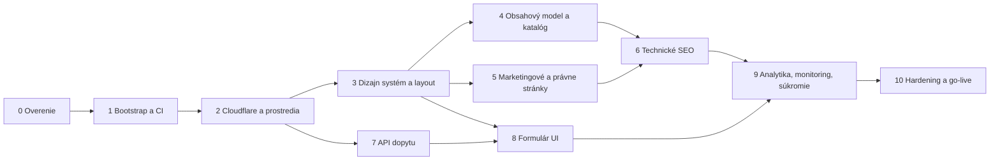

# PLAN.md — Passit: B2B web distribútora talianskych potravín

> Stav: **návrh na schválenie (revízia 2)**. Kód sa začne písať až po výslovnom „Schvaľujem, poďme na Fázu 1“.
> Pracovný názov projektu „Passit“ je odvodený z názvu priečinka (**ASSUMPTION A1**).
> _*Číslovanie sekcií (A–E) a ID (A*, Q_, R-_, ADR-_) je stabilné.** Odkazuje sa naň `AGENTS.md`. Zmeny oproti revízii 1 sú v sekcii F.
> Značka **[MANUÁLNE]** označuje krok, ktorý robí vlastník (prístupy, účty, nastavenia na platformách), nie AI agent.

## 0. Zhrnutie vstupov

| Oblasť        | Vstup od klienta                                                                                           | Dôsledok                                                                                   |
| ------------- | ---------------------------------------------------------------------------------------------------------- | ------------------------------------------------------------------------------------------ |
| Biznis        | Distribúcia talianskych potravín pre HoReCa (reštaurácie, pizzerie, hotely, catering, gastro profesionáli) | B2B web zameraný na získanie odberateľa: katalóg sortimentu a dopyt namiesto e-shopu       |
| Správa obsahu | Zatiaľ vývojár                                                                                             | Obsah je v gite, typovo validovaný; CMS sa nezavádza                                       |
| Jazyky        | SK                                                                                                         | Bez i18n routingu a bez `hreflang`; texty sú centralizované, aby sa EN dalo doplniť neskôr |
| Hosting       | Cloudflare                                                                                                 | Cloudflare Workers so statickými assetmi, Turnstile, WAF, Web Analytics                    |
| Integrácie    | CRM nie je, e-mail je Google Workspace                                                                     | Dopyt sa doručí e-mailom do Workspace schránky, aplikácia nič neukladá do databázy         |
| Analytika     | „Ak má Cloudflare niečo ako Vercel“                                                                        | Áno: **Cloudflare Web Analytics** je zadarmo, bez cookies a bez fingerprintingu            |

**Zmena oproti Kroku 1:** namiesto Next.js navrhujem **Astro**. Odpovede (žiadny CMS, len SK, Cloudflare, prevažne statický obsah) odstránili hlavné dôvody pre Next.js (ISR s CMS webhookmi, `next-intl`). Next.js na Cloudflare vyžaduje adaptér OpenNext s vlastnou konfiguráciou cache. Astro má first-party adaptér pre Cloudflare, Zod schémy obsahu priamo vo frameworku a do prehliadača neposiela žiadny JS, ak nie je potrebný. Podrobnosti sú v ADR-001.

---

## A. Architektúra

### A.1 Technológie a kompromisy

| Vrstva            | Voľba                                                                                            | Dôvod                                                                                                                                                                                       | Kompromis                                                                                                               |
| ----------------- | ------------------------------------------------------------------------------------------------ | ------------------------------------------------------------------------------------------------------------------------------------------------------------------------------------------- | ----------------------------------------------------------------------------------------------------------------------- |
| Framework         | **Astro** (aktuálna stabilná major verzia, presne pinovaná) + **TypeScript strict**              | Statické HTML a nulový JS ako predvoľba. Content Collections validujú obsah Zodom pri builde. `astro:env` oddeľuje serverové secrets od klienta. First-party adaptér `@astrojs/cloudflare`. | Menší ekosystém UI knižníc ako pri React/Next. Interaktivitu (mobilné menu, formulár) píšeme vo vanilla TS.             |
| Runtime / hosting | **Cloudflare Workers + Static Assets**                                                           | Statické súbory sa servírujú bez spúšťania Workera. Worker beží len pre `/api/*`. Verzie, preview URL a okamžitý rollback sú súčasťou platformy.                                            | Workers runtime nie je plný Node.js (napr. `sharp` nefunguje za behu), preto obrázky optimalizujeme pri builde.         |
| Backend / API     | Jediný on-demand endpoint `POST /api/dopyt`                                                      | Minimálna plocha pre útok; ostatné stránky sú prerenderované.                                                                                                                               | Bez SSR nie sú personalizované stránky (nepotrebujeme ich).                                                             |
| Databáza          | **Žiadna**                                                                                       | Dopyty sa posielajú e-mailom a obsah žije v gite. Aplikácia neukladá osobné údaje, čo znižuje GDPR riziko.                                                                                  | Ak zlyhá doručenie e-mailu, dopyt sa stratí. Mitigácia: chyba 502 s telefónom a e-mailom; neskôr možný D1 outbox (R-3). |
| Obsah             | **Astro Content Collections** (Markdown + YAML so Zod schémou)                                   | Obsah edituje vývojár, prechádza cez code review a neplatné dáta zastavia build.                                                                                                            | Netechnický editor ho nezmení. Cesta k CMS je v ADR-002 (Keystatic alebo Storyblok).                                    |
| Styling           | **Tailwind CSS v4** (CSS-first `@theme` tokeny)                                                  | Kompiluje sa do externého CSS, takže nevznikajú inline štýly a CSP ostáva striktná.                                                                                                         | Dlhé triedy v markupe; riešené malými komponentmi.                                                                      |
| Validácia         | **Zod** cez `astro/zod`, jedna schéma pre klienta aj server                                      | Rovnaké pravidlá na oboch stranách bez ďalšej závislosti.                                                                                                                                   | —                                                                                                                       |
| Anti-spam         | **Cloudflare Turnstile** + honeypot + time-trap                                                  | Bez cookies a bez obrázkových CAPTCHA; ten istý dodávateľ ako hosting.                                                                                                                      | Bez JS sa formulár neodošle. Pre takých návštevníkov je viditeľný telefón a e-mail.                                     |
| E-mail            | **Resend, EU región** (volaný cez `fetch`, bez SDK) zo subdomény `mail.<doména>`                 | Doručiteľnosť cez SPF/DKIM/DMARC bez zásahu do MX záznamov Workspace.                                                                                                                       | Ďalší spracovateľ (vyžaduje DPA). Alternatívy sú v ADR-007.                                                             |
| Rate limiting     | **Cloudflare WAF rule** + **Workers Rate Limiting binding**                                      | Stav drží Cloudflare (WAF na hrane, binding v počítadlách danej lokality), nie pamäť inštancie.                                                                                             | Binding je približný (per lokalita, okno 10 alebo 60 s). Stačí ako doplnok k Turnstile.                                 |
| Analytika         | **Cloudflare Web Analytics**                                                                     | Bez cookies, a teda bez cookie lišty (**ASSUMPTION A17**, potvrdiť právne).                                                                                                                 | Nemeria vlastné udalosti ani konverzie. Konverzie počíta server cez Workers Analytics Engine bez PII (Fáza 9).          |
| Package manager   | **pnpm** (presné verzie, `minimumReleaseAge` 7 dní, lifecycle skripty len zo zoznamu povolených) | Ochrana dodávateľského reťazca.                                                                                                                                                             | —                                                                                                                       |

### A.2 Adresárová štruktúra

```text
/                                   # koreň repozitára
├─ .github/
│  ├─ workflows/ci.yml              # lint, typecheck, unit, build, check:dist, e2e, axe, LHCI, audit, gitleaks
│  ├─ workflows/deploy.yml          # PR preview → staging (main) → prod (manuálne schválenie)
│  ├─ pull_request_template.md      # odkaz na fázu + checklist akceptačných kritérií
│  └─ CODEOWNERS
├─ .vscode/extensions.json          # odporúčané rozšírenia (voliteľné)
├─ public/
│  ├─ .well-known/security.txt      # RFC 9116 (Contact, Expires, Preferred-Languages)
│  ├─ _redirects                    # 301 presmerovania
│  ├─ favicon.svg
│  └─ apple-touch-icon.png
├─ scripts/
│  ├─ check-dist.ts                 # kontrola buildu: inline <script>/style=, secrets, JS/CSS rozpočet, PLACEHOLDER, security.txt Expires
│  ├─ generate-headers.ts           # generuje dist/_headers podľa PUBLIC_ENV a CSP_MODE (bezpečnostné + cache hlavičky)
│  └─ not-configured.mjs            # dočasný stub skriptov, ktoré vzniknú v neskoršej fáze (viď D, Krok 0)
├─ src/
│  ├─ content.config.ts             # Zod schémy kolekcií (categories, products, brands, segments)
│  ├─ content/
│  │  ├─ categories/*.yaml
│  │  ├─ products/*.md
│  │  ├─ brands/*.yaml
│  │  └─ segments/*.md              # pizzerie, reštaurácie, hotely, catering
│  ├─ assets/images/                # zdrojové obrázky (optimalizované cez astro:assets pri builde)
│  ├─ components/
│  │  ├─ ui/                        # Button, Container, Heading, Badge, Card, Field, Select, Textarea, Alert, SkipLink, Breadcrumbs
│  │  ├─ layout/                    # Header, MobileNav (+ mobile-nav.ts), Footer, CompanyInfo
│  │  ├─ sections/                  # Hero, UspList, CategoryGrid, SegmentTeaser, BrandStrip, DeliveryArea, CtaBand
│  │  ├─ catalog/                   # ProductCard, ProductGrid, ProductSpecs, CertificationBadge, PackagingTable
│  │  ├─ forms/                     # InquiryForm.astro, inquiry-form.ts (klient), Turnstile.astro, ErrorSummary.astro
│  │  └─ seo/                       # Seo.astro, JsonLd.astro (jediné povolené miesto pre set:html)
│  ├─ layouts/                      # BaseLayout.astro, PageLayout.astro, LegalLayout.astro
│  ├─ pages/
│  │  ├─ index.astro
│  │  ├─ sortiment/index.astro
│  │  ├─ sortiment/[category].astro
│  │  ├─ produkt/[slug].astro       # plochá URL: stabilná aj pri presune produktu do inej kategórie
│  │  ├─ pre-koho/index.astro
│  │  ├─ pre-koho/[segment].astro
│  │  ├─ o-nas.astro
│  │  ├─ distribucia.astro          # oblasť a podmienky rozvozu
│  │  ├─ kontakt.astro              # kontakty + dopytový formulár
│  │  ├─ ochrana-osobnych-udajov.astro
│  │  ├─ cookies.astro
│  │  ├─ 404.astro
│  │  ├─ robots.txt.ts              # podľa prostredia (staging = Disallow: /)
│  │  └─ api/dopyt.ts               # export const prerender = false
│  ├─ lib/
│  │  ├─ schemas/inquiry.ts         # zdieľaná Zod schéma (klient + server)
│  │  ├─ server/                    # LEN server; import z klienta zakáže ESLint
│  │  │  ├─ http.ts                 # JSON odpovede, bezpečnostné hlavičky API, limit veľkosti tela
│  │  │  ├─ origin.ts               # validácia Origin / Sec-Fetch-Site
│  │  │  ├─ turnstile.ts            # siteverify (hostname, action, idempotency)
│  │  │  ├─ rate-limit.ts           # obal nad Workers Rate Limiting binding
│  │  │  ├─ mailer.ts               # Resend cez fetch; plaintext + escapované HTML, bez CRLF injekcie
│  │  │  ├─ metrics.ts              # zápis konverzií do Analytics Engine (Fáza 9)
│  │  │  └─ logger.ts               # štruktúrované logy s whitelistom polí (bez PII)
│  │  ├─ seo/                       # meta.ts, jsonld.ts (buildery so safe serializáciou)
│  │  ├─ site.ts                    # firemné údaje (IČO, DIČ, adresa…) validované Zodom
│  │  └─ utils/                     # format.ts (čísla, balenia), slug.ts
│  ├─ styles/global.css             # Tailwind v4 + @theme tokeny
│  └─ env.d.ts
├─ tests/
│  ├─ unit/                         # schémy, origin, turnstile, rate-limit, mailer, logger, headers, kontrast tokenov, obsah
│  ├─ e2e/                          # navigácia, katalóg, formulár, klávesnica, SEO, hlavičky, CSP violations
│  └─ security/                     # API: 400/403/405/413/415/429 scenáre
├─ astro.config.ts
├─ wrangler.jsonc                   # Worker, assets (html_handling), rate limit binding, observability, prostredia staging/production
├─ tsconfig.json
├─ eslint.config.js
├─ prettier.config.js
├─ vitest.config.ts
├─ playwright.config.ts
├─ lighthouserc.cjs
├─ renovate.json
├─ .gitleaks.toml
├─ .dev.vars.example                # vzor lokálnych secrets (skutočný .dev.vars je v .gitignore)
├─ .nvmrc                           # Node LTS
├─ .npmrc / pnpm-workspace.yaml     # save-exact, minimumReleaseAge, onlyBuiltDependencies
├─ package.json / pnpm-lock.yaml
├─ AGENTS.md
├─ PLAN.md
└─ README.md
```

### A.3 Dátový model obsahu

Obsah žije v Content Collections v gite. Databáza nie je potrebná, lebo jediné dynamické dáta (dopyty) sa iba prepošlú e-mailom. Katalóg sa mení zriedka, mení ho vývojár a code review je zároveň schvaľovací proces obsahu.

**Tvar schém (náčrt, nie implementácia):**

```ts
// categories/*.yaml
{ title: string(2..60), description: string(..300), order: int, image: image(), seoDescription: string(..160) }

// brands/*.yaml
{ name: string, region?: ItalianRegion, website?: url, logo?: image() }

// products/*.md (frontmatter + markdown popis)
{
  title: string(2..90),            // SK názov, napr. „Mozzarella Fior di Latte“
  originalName?: string,           // taliansky názov
  category: reference('categories'),
  brand?: reference('brands'),
  region?: ItalianRegion,          // enum 20 talianskych regiónov
  certifications: ('DOP'|'IGP'|'STG'|'BIO')[],
  packaging: { amount: number>0, unit: 'g'|'kg'|'ml'|'l'|'ks', perCarton?: int }[] (min 1),
  storage: 'suche'|'chladene'|'mrazene',
  shelfLifeDays?: int,
  allergens: Allergen[],           // 14 alergénov podľa nariadenia (EÚ) 1169/2011
  summary: string(50..160),        // aj meta description
  images: image()[] (min 1),
  segments: reference('segments')[],
  featured: boolean = false,
  available: boolean = true,
}

// segments/*.md
{ title: string, intro: string(..300), recommendedCategories: reference('categories')[], heroImage: image() }
```

`src/lib/site.ts` obsahuje firemnú identitu: obchodné meno, sídlo, IČO, DIČ, IČ DPH, zápis v OR, kontakty, otváracie hodiny, oblasť rozvozu a voliteľne registračné číslo ŠVPS. Pri builde ju validuje Zod. V produkčnom builde (`PUBLIC_ENV=production`) chýbajúce povinné údaje alebo zostatok `PLACEHOLDER` zastavia build (Fáza 10). Staging a preview týmto pravidlom nie sú blokované.

**Ceny sa nezverejňujú.** B2B cenník je na vyžiadanie (**ASSUMPTION A6**).

### A.4 Prostredia, vetvy, CI/CD, rollback

| Prostredie | `PUBLIC_ENV` | Kde                                                              | Spúšťač                                               | Secrets / kľúče                                            | Indexovanie                                                    |
| ---------- | ------------ | ---------------------------------------------------------------- | ----------------------------------------------------- | ---------------------------------------------------------- | -------------------------------------------------------------- |
| dev        | `dev`        | `astro dev`; prod-like test cez `wrangler dev`                   | lokálne                                               | `.dev.vars`, Turnstile **test keys**, `MAIL_TRANSPORT=log` | —                                                              |
| preview    | `preview`    | preview URL verzie Workera `passit-web-staging` (alias `pr-<n>`) | každý PR                                              | staging secrets, e-maily idú na adresu vývojára            | `robots: Disallow`, `X-Robots-Tag: noindex`, Cloudflare Access |
| staging    | `staging`    | Worker `passit-web-staging`                                      | merge do `main`                                       | staging secrets                                            | rovnako ako preview                                            |
| prod       | `production` | Worker `passit-web` na vlastnej doméne                           | manuálne schválenie v GitHub Environment `production` | produkčné secrets, Turnstile prod kľúče viazané na doménu  | povolené                                                       |

- **Vetvy:** trunk-based. `main` je chránená (GitHub ruleset): povinný PR, povinné status checks, povinné schválenie vlastníkom kódu (CODEOWNERS), lineárna história, zákaz force-push, platí aj pre adminov. Pracovné vetvy sa volajú `phase/NN-nazov`, merguje sa squashom a commity dodržiavajú Conventional Commits.
- **Prístupy agenta (A26):** AI agent pracuje pod **samostatným GitHub účtom alebo fine-grained tokenom** s právom zapisovať do vetiev a otvárať PR, ale **bez práva mergovať, meniť nastavenia repozitára, secrets a rulesets**. Dôvod: ak by agent používal účet vlastníka, CODEOWNERS ani branch protection by ho nezastavili, a vlastník by si ako jediný človek nemohol schváliť PR niekoho iného. Vlastník schvaľuje a mergne každý PR. **[MANUÁLNE]**
- **CI** (`ci.yml`, beží na každý PR): install `--frozen-lockfile`, lint, typecheck, unit testy, build, `check:dist`, e2e + axe, Lighthouse CI, `pnpm audit`, gitleaks. Skripty, ktoré vzniknú až v neskoršej fáze, sú do tej doby stuby (viď D, Krok 0).
- **CD** (`deploy.yml`): pri PR `wrangler versions upload` s preview aliasom a komentárom s URL v PR. Pri merge do `main` deploy na staging. Prod sa nasadzuje cez `workflow_dispatch` so schválením. Pred prod deployom sa automaticky overí, že `MAIL_TRANSPORT=resend`, `PUBLIC_ENV=production`, nepoužívajú sa Turnstile test keys a build neobsahuje `PLACEHOLDER`.
- **Rollback:** `wrangler rollback <version-id>` alebo dashboard (okamžité, bez rebuildu). Pri chybe v kóde nasleduje `git revert` a nový deploy. Rollback nevracia zmeny secrets a bindingov, preto sa tie menia v samostatnom kroku a zapisujú do runbooku v README.
- GitHub Actions sú pinované na commit SHA, `permissions:` sú minimálne a `CLOUDFLARE_API_TOKEN` má len oprávnenie na Workers deploy pre daný účet. Token je v GitHub Environment secrets a agent k nemu nemá prístup.

### A.5 Dizajnový systém a UX

- **Informačná architektúra:** Domov → Sortiment (kategórie → produkt) → Pre koho (segmenty) → Distribúcia → O nás → Kontakt/Dopyt. Primárna CTA je „Stať sa odberateľom“ alebo „Vyžiadať cenník“, sekundárna je klik na telefón (gastro prevádzkari používajú najmä mobil).
- **Produktová stránka pre B2B:** balenie a počet kusov v kartóne, skladovanie (suché/chladené/mrazené), trvanlivosť, certifikácia DOP/IGP, alergény a CTA „Mám záujem“, ktorá predvyplní dopyt (`/kontakt?produkt=<slug>`).
- **Vizuálny smer (ASSUMPTION A9, kým nedodáte brand manuál):** teplá krémová plocha, tmavý atramentový text, paradajková červená pre CTA, olivová ako sekundárna farba; kvalitná fotografia produktov; bez klišé trikolóry. Všetky dvojice tokenov text/pozadie musia mať kontrast ≥ 4,5 : 1, čo overuje unit test.
- **Typografia:** dve variabilné rodiny (serif na nadpisy, sans na text) so subsetmi latin + latin-ext, self-hosted.
- **Mobile-first**, dotykové ciele ≥ 24 × 24 px (WCAG 2.5.8), odporúčane 44 px.

---

## B. Bezpečnosť

### B.1 Threat model

| ID  | Útočník / hrozba                                            | Cieľ                                     | Dopad                                            | Opatrenia                                                                                                                                                                                           |
| --- | ----------------------------------------------------------- | ---------------------------------------- | ------------------------------------------------ | --------------------------------------------------------------------------------------------------------------------------------------------------------------------------------------------------- |
| T1  | Spam boty                                                   | Zaplaviť dopytový formulár               | Zahltená schránka, náklady na e-maily            | Turnstile, honeypot, time-trap, WAF rate rule, RL binding, limit veľkosti tela                                                                                                                      |
| T2  | Zneužitie formulára ako e-mail relay alebo header injection | Posielať e-maily tretím stranám          | Blacklist domény, phishing                       | Pevný príjemca na serveri, žiadne potvrdzovacie e-maily na zadanú adresu, `Reply-To` len po validácii, zákaz CR/LF v jednoriadkových poliach, escapovanie HTML tela                                 |
| T3  | XSS                                                         | Spustiť skript v prehliadači návštevníka | Defacement, krádež dát                           | Používateľský vstup sa nikdy nevykresľuje na webe, `set:html` je zakázaný (okrem JsonLd so safe serializáciou), striktná CSP bez `unsafe-inline`, `check-dist`                                      |
| T4  | Únik osobných údajov                                        | Dáta z dopytov                           | GDPR incident                                    | Aplikácia dopyty neukladá; dáta ostávajú iba vo Workspace schránke a v retencii Resend (overené vo Fáze 7). Logy bez PII, invocation logy minimalizované, TLS + HSTS, minimálny okruh spracovateľov |
| T5  | Kompromitácia závislostí                                    | Škodlivý kód v builde                    | Kompletná kompromitácia webu                     | Lockfile, presné verzie, `minimumReleaseAge`, blokované lifecycle skripty, Renovate, audit v CI, schvaľovanie nových závislostí                                                                     |
| T6  | Únik secrets                                                | API kľúče (Resend, Turnstile, CF token)  | Zneužitie odosielania, deploy útočníkom          | `astro:env` so `access: "secret"`, gitleaks + GitHub push protection, sken `dist/`, scoped tokeny, rotácia                                                                                          |
| T7  | Clickjacking                                                | Vložiť web do cudzej stránky             | Podvodné kliky                                   | `frame-ancestors 'none'`, `X-Frame-Options: DENY`                                                                                                                                                   |
| T8  | Scraping katalógu                                           | Kopírovanie sortimentu                   | Nízky (obsah je verejný, ceny nie)               | Žiadne ceny; Cloudflare bot nastavenia; rozhodnutie o AI crawleroch (A20)                                                                                                                           |
| T9  | DoS / nákladový útok                                        | Zahltiť Worker                           | Nedostupnosť formulára                           | Statika sa servíruje bez Workera, WAF, RL, kvóty                                                                                                                                                    |
| T10 | Prevzatie účtu (GitHub, Cloudflare, Resend, Google)         | Kontrola nad webom alebo DNS             | Kritický                                         | Povinné 2FA (prednostne passkey), minimálne oprávnenia, samostatný účet agenta bez práva mergovať, CODEOWNERS, ochrana `main`, schvaľovanie prod deployu                                            |
| T11 | Únos DNS alebo domény                                       | Presmerovanie návštevníkov a e-mailov    | Kritický                                         | Registrar lock, DNSSEC, CAA záznam                                                                                                                                                                  |
| T12 | CSRF na API                                                 | Odoslanie dopytu z cudzej stránky        | Spam v mene obete (nízky, keďže nie sú sessions) | Kontrola Origin (Astro `checkOrigin` + vlastná), Turnstile token viazaný na hostname                                                                                                                |

### B.2 Validácia a sanitizácia

- **Jedna Zod schéma** v `src/lib/schemas/inquiry.ts`. Klient ju používa na okamžitú spätnú väzbu, server ju vynucuje vždy a výsledok klientskej validácie nikdy nepovažuje za dôveryhodný.

```ts
// náčrt tvaru
inquirySchema = z
  .object({
    name: singleLine(2, 100),
    company: singleLine(2, 150),
    ico: z
      .string()
      .regex(/^\d{8}$/)
      .optional(),
    businessType: z.enum([
      'restauracia',
      'pizzeria',
      'hotel',
      'catering',
      'ine',
    ]),
    city: singleLine(2, 100),
    email: z.email().max(254),
    phone: z
      .string()
      .regex(/^\+?[0-9 ]{9,16}$/)
      .optional(),
    message: z.string().trim().max(2000),
    product: z
      .string()
      .regex(/^[a-z0-9-]{1,80}$/)
      .optional(),
    website: z.string().max(200), // honeypot: schéma ho PRIJME; vyhodnocuje sa v B.3 (krok 6)
    elapsedMs: z.coerce.number().int().min(0).max(86_400_000), // time-trap (B.3, krok 8)
    turnstileToken: z.string().min(1).max(2048),
  })
  .strict();
// singleLine = trim + dĺžka + zákaz \r \n a riadiacich znakov
```

- **Názov poľa Turnstile:** widget vkladá do formulára pole `cf-turnstile-response`. Server ho pred validáciou **premapuje** na `turnstileToken` (jedna malá funkcia v `api/dopyt.ts`, pokrytá unit testom). Schéma preto môže zostať `.strict()` a nezamietne reálne požiadavky.
- **Honeypot nesmie byť vynútený schémou.** Keby bolo `website: z.literal('')`, vyplnený honeypot by zlyhal na validácii a bot by dostal 400 namiesto tichej odpovede 200.
- **Výstup:** Astro escapuje výrazy v šablónach automaticky. `set:html` a `is:inline` zakazuje ESLint aj AGENTS.md. Jedinou výnimkou je `JsonLd.astro`: `JSON.stringify` + nahradenie `<` sekvenciou `\u003c`.
- **Markdown obsah** píše len vývojár cez review. Surové HTML v Markdown je zakázané pravidlom v review a `check-dist` overí, že v buildu nie sú inline skripty ani `on*=` atribúty.
- **E-mail:** plaintext + jednoduché HTML. Každá hodnota sa HTML-escapuje. Predmet je pevný šablónový reťazec (`Nový dopyt: <typ prevádzky>` zo `enum`), žiadny voľný text.

### B.3 Formuláre a API (`POST /api/dopyt`)

Poradie spracovania (lacné kontroly idú prvé):

1. Metóda musí byť `POST`, inak **405**.
2. `Content-Type: application/x-www-form-urlencoded`, inak **415**. Je to jediný podporovaný formát, takže máme jednu cestu kódu. Klient preto posiela `URLSearchParams`, nie `FormData` (to by išlo ako `multipart/form-data`).
3. `Content-Length` ≤ 16 KB a skutočné čítanie tela je obmedzené, inak **413**.
4. **Origin:** `Origin` sa musí rovnať originu požiadavky a `Sec-Fetch-Site` (ak je prítomný) musí byť `same-origin`, inak **403**. Duplicitne je zapnutý aj Astro `security.checkOrigin`. Keďže nie sú cookies ani sessions, CSRF tokeny netreba; ochranu tvorí Origin + Turnstile.
5. **Rate limit:** Workers Rate Limiting binding s kľúčom podľa IP (`CF-Connecting-IP`; IP sa nikde neloguje), 3 požiadavky za 60 s, inak **429** s `Retry-After`. Na hrane navyše WAF pravidlo na `/api/dopyt` (limity podľa plánu Cloudflare). Pamäť inštancie sa nepoužíva, lebo v serverless prostredí nie je zdieľaná.
6. **Honeypot na surových dátach, pred Zodom:** ak je pole `website` neprázdne, tichý drop s odpoveďou **200** `{ok:true}` bez odoslania, **aj keď je zvyšok požiadavky nevalidný**. Bot sa tak nič nenaučí.
7. **Premapovanie `cf-turnstile-response` → `turnstileToken`** a **Zod validácia**, inak **400** so zoznamom polí, nie s hodnotami.
8. **Time-trap:** `elapsedMs < 3000` vedie k rovnakému tichému dropu s 200. Kompromis: na statickej stránke sa čas nedá podpísať serverom, preto je time-trap len slabá vrstva.
9. **Turnstile siteverify:** overí sa `success`, `hostname` (zoznam povolených podľa prostredia) a `action === 'dopyt'`. Chýbajúci alebo neplatný token vráti **400**. Tokeny sú jednorazové.
10. **Odoslanie e-mailu** (Resend, timeout 5 s), inak **502** s hláškou obsahujúcou telefón a e-mail.
11. Odpoveď **200** `{ok:true}`.

Všetky odpovede API majú `Cache-Control: no-store`, `Content-Type: application/json; charset=utf-8`, `X-Content-Type-Options: nosniff`. Hlavička `Access-Control-Allow-Origin` sa neposiela a `OPTIONS` vracia 405.

### B.4 Secrets a env premenné

Definované cez `astro:env` (typované, validované pri štarte). Čokoľvek s `access: "secret"` nemôže skončiť v klientskom bundli, lebo import z klientskeho kódu zlyhá pri builde. Prefix `PUBLIC_` (Astro ekvivalent `NEXT_PUBLIC_*`) je vyhradený pre verejné hodnoty.

| Názov                       | Účel                                                                                                  | Klient / server  | Prostredia                                      | Uloženie                        | Rotácia                         |
| --------------------------- | ----------------------------------------------------------------------------------------------------- | ---------------- | ----------------------------------------------- | ------------------------------- | ------------------------------- |
| `TURNSTILE_SECRET_KEY`      | Overenie Turnstile tokenu                                                                             | server, secret   | dev (test key), staging, prod                   | `.dev.vars` / `wrangler secret` | 12 mesiacov alebo pri incidente |
| `PUBLIC_TURNSTILE_SITE_KEY` | Vykreslenie widgetu                                                                                   | klient (verejné) | všetky                                          | `wrangler.jsonc` vars           | spolu so secretom               |
| `RESEND_API_KEY`            | Odosielanie e-mailov (iba „sending access“ na jednu doménu)                                           | server, secret   | staging, prod (dev = `log`)                     | `wrangler secret`               | 6 mesiacov                      |
| `MAIL_TRANSPORT`            | `resend` alebo `log`                                                                                  | server           | všetky (prod musí byť `resend`, overuje deploy) | vars                            | —                               |
| `INQUIRY_TO_EMAIL`          | Príjemca dopytov (Workspace)                                                                          | server           | staging (vývojár), prod (klient)                | vars                            | pri zmene                       |
| `INQUIRY_FROM_EMAIL`        | Odosielateľ, napr. `web@mail.<doména>`                                                                | server           | staging, prod                                   | vars                            | —                               |
| `PUBLIC_SITE_URL`           | Kanonické URL, sitemap                                                                                | klient + server  | všetky                                          | vars / build env                | —                               |
| `PUBLIC_ENV`                | `dev` / `preview` / `staging` / `production`; riadi indexovanie, build gate pre `PLACEHOLDER`, beacon | klient + server  | všetky                                          | build env                       | —                               |
| `CSP_MODE`                  | `report-only` alebo `enforce`; číta ho `generate-headers.ts`                                          | len build        | všetky                                          | build env                       | —                               |
| `PUBLIC_CF_ANALYTICS_TOKEN` | Beacon Web Analytics (token je z princípu verejný)                                                    | klient           | len prod                                        | build env                       | —                               |
| `ALLOWED_HOSTNAMES`         | Zoznam hostnames pre kontrolu Turnstile                                                               | server           | všetky                                          | vars                            | —                               |
| `CLOUDFLARE_API_TOKEN`      | Deploy z CI (scoped: Workers Scripts Edit)                                                            | len CI           | —                                               | GitHub Environment secret       | 90 dní                          |
| `CLOUDFLARE_ACCOUNT_ID`     | Deploy z CI                                                                                           | len CI           | —                                               | GitHub secret                   | —                               |

**Kontrola úniku:**

- GitHub secret scanning + push protection (dostupnosť pre súkromný repozitár viď A27).
- `gitleaks` v CI (blokuje merge) a ako pre-commit hook (zdokumentovaný v README).
- `.dev.vars` a `.env*` sú v `.gitignore`.
- `scripts/check-dist.ts` prehľadá `dist/` na vzory kľúčov (`re_…`, `0x4AAA…` secret formát, `-----BEGIN`) a na názvy serverových premenných. Pri náleze build zlyhá.

### B.5 Security headers

Hlavičky pre statické stránky generuje `scripts/generate-headers.ts` do `dist/_headers` podľa `PUBLIC_ENV` a `CSP_MODE` (jeden zdroj pravdy, testovaný unit testom `headers.test.ts`). Hlavičky API nastavuje `src/lib/server/http.ts`.

**Rozhodnutie o CSP (ADR-005):** CSP ako HTTP hlavička **bez nonce a bez hashov**. Dosiahneme to tým, že build neobsahuje žiadne inline skripty ani štýly:

- Astro skripty sa bundlujú do externých súborov (vypnuté inlinovanie malých skriptov aj CSS: `build.inlineStylesheets: 'never'`, `assetsInlineLimit: 0`).
- JSON-LD (`type="application/ld+json"`) sa nevykonáva, takže pod `script-src` nespadá.
- `check-dist` v CI zlyhá pri akomkoľvek inline `<script>` bez `src` (okrem JSON-LD), `style=` atribúte alebo `on*=` handleri.

```text
Content-Security-Policy:            # v režime report-only sa posiela pod názvom Content-Security-Policy-Report-Only
  default-src 'self';
  script-src 'self' https://challenges.cloudflare.com https://static.cloudflareinsights.com;
  style-src 'self';
  img-src 'self' data:;
  font-src 'self';
  connect-src 'self' https://cloudflareinsights.com;
  frame-src https://challenges.cloudflare.com;
  frame-ancestors 'none';           # v meta/report-only režime sa frame-ancestors ignoruje, preto je okrem CSP aj X-Frame-Options
  base-uri 'none';
  form-action 'self';
  object-src 'none';
  upgrade-insecure-requests
Strict-Transport-Security: max-age=63072000; includeSubDomains   (rampa: 300 → 86400 → 2 roky; preload až po overení)
X-Content-Type-Options: nosniff
X-Frame-Options: DENY
Referrer-Policy: strict-origin-when-cross-origin
Permissions-Policy: camera=(), microphone=(), geolocation=(), payment=(), usb=(), browsing-topics=()
Cross-Origin-Opener-Policy: same-origin
```

**Zavádzanie CSP (report-only → enforce):**

| Krok     | Prostredie       | Režim                                                                                                                                                  | Podmienka prechodu                                                                    |
| -------- | ---------------- | ------------------------------------------------------------------------------------------------------------------------------------------------------ | ------------------------------------------------------------------------------------- |
| Fázy 2–7 | preview, staging | `report-only`                                                                                                                                          | e2e hlási 0 `securitypolicyviolation` udalostí                                        |
| Fáza 8   | preview, staging | `enforce`                                                                                                                                              | po pridaní Turnstile: 0 violations v e2e a ručná kontrola v Chrome, Safari a Firefoxe |
| Fáza 10  | prod             | najprv `report-only` pri smoke teste na reálnej doméne (Cloudflare môže na hrane vkladať vlastné skripty), potom `enforce` v rámci toho istého go-live | 0 violations v konzole na všetkých typoch stránok                                     |

**Kompromisy, explicitne:**

| Téma                            | Kompromis                                                                                                                                                                                                                                                                                                                                                               |
| ------------------------------- | ----------------------------------------------------------------------------------------------------------------------------------------------------------------------------------------------------------------------------------------------------------------------------------------------------------------------------------------------------------------------- |
| Statické renderovanie vs. nonce | Nonce vyžaduje generovanie každej stránky pri požiadavke, čím by sa stratila CDN statika a výkon. Riešime to nulovými inline skriptami. Ak by inline skript bol nevyhnutný, prejdeme na hash-based CSP cez Astro `security.csp` (meta tag) a v HTTP hlavičke ponecháme len direktívy, ktoré meta nepodporuje (`frame-ancestors`), lebo viac CSP sa kombinuje prienikom. |
| Turnstile                       | Vyžaduje `script-src` a `frame-src` pre `challenges.cloudflare.com`. **COEP nenastavujeme**, lebo by rozbil iframe Turnstile. Ak by widget potreboval inline štýly, doplní sa `style-src 'unsafe-inline'` iba po overení vo Fáze 8 (nízke riziko, zdokumentované).                                                                                                      |
| Analytika                       | Beacon načítame explicitne (nie auto-injection), len v prod. Pridáva jeden script a jeden connect origin.                                                                                                                                                                                                                                                               |
| Fonty                           | Self-hosted, teda `font-src 'self'`. Žiadne Google Fonts (GDPR aj ďalší origin).                                                                                                                                                                                                                                                                                        |
| Cloudflare zónové funkcie       | **Vypnúť** Rocket Loader, Email Address Obfuscation, auto-injection Web Analytics a Zaraz. Vkladajú inline skripty a porušili by CSP (kontrola v runbooku vo Fáze 10).                                                                                                                                                                                                  |
| Mapa                            | Žiadny Google Maps embed (cookies, CSP, výkon). Namiesto neho statický obrázok alebo SVG a odkaz „Otvoriť v Mapách“.                                                                                                                                                                                                                                                    |

**CORS:** API je výlučne same-origin, žiadne CORS hlavičky. Statické assety tiež bez CORS.

**Cache:** `/_astro/*` dostane `public, max-age=31536000, immutable`; HTML `public, max-age=0, must-revalidate`.

### B.6 Dodávateľský reťazec

- `pnpm-lock.yaml` je commitnutý a CI používa `--frozen-lockfile`.
- `save-exact=true`, teda žiadne `^` ani `~`.
- `minimumReleaseAge` **7 dní** (rovnako v pnpm, ak ho verzia podporuje, aj v Renovate) bráni okamžitej inštalácii čerstvo vydaných, potenciálne kompromitovaných verzií. Security updaty môže vlastník schváliť skôr ručne.
- Lifecycle skripty (`postinstall`) sú povolené len pre balíky na zozname `onlyBuiltDependencies` (napr. `esbuild`, `sharp`, `workerd`).
- **Renovate:** týždenne, zoskupené minor/patch, security update ihneď, major verzie vždy samostatný PR. Automerge len pre devDependencies patch so zelenými checkmi (vyžaduje váš súhlas, A21). Dependabot sa nepoužíva (ADR-013).
- `pnpm audit --audit-level=high` v CI blokuje merge. Moderate sa reportuje.
- GitHub Actions sú pinované na SHA a aktualizuje ich Renovate.
- **Nové závislosti:** iba s vaším schválením v PR. Popis musí uviesť účel, licenciu, veľkosť, údržbu (posledný release, počet maintainerov) a alternatívu bez závislosti.
- **Počiatočný zoznam závislostí na schválenie vo Fáze 1:**
  - runtime: `astro`, `@astrojs/cloudflare`, `@astrojs/sitemap`, `tailwindcss`, `@tailwindcss/vite`, `@fontsource-variable/<2 rodiny>`
  - dev: `typescript`, `@astrojs/check`, `eslint`, `@eslint/js`, `typescript-eslint`, `eslint-plugin-astro`, `eslint-plugin-jsx-a11y`, `@eslint-community/eslint-plugin-eslint-comments`, `prettier`, `prettier-plugin-astro`, `vitest`, `@vitest/coverage-v8`, `@playwright/test`, `@axe-core/playwright`, `@lhci/cli`, `wrangler`
  - gitleaks beží ako binárka v CI, nie ako npm balík.

### B.7 GDPR a súkromie

**Cookies:** web nenastavuje žiadne vlastné cookies. Cloudflare môže nastaviť nevyhnutné bezpečnostné cookies (napr. `__cf_bm` pri bot ochrane). Turnstile ani Web Analytics podľa Cloudflare cookies na sledovanie nepoužívajú.
→ **Žiadna cookie lišta v MVP** (**ASSUMPTION A17**, potvrdí právnik). Stránka `/cookies` informuje o nevyhnutných cookies.
→ **Architektúra pre budúcnosť:** keby pribudol nepovinný skript (GA4, Meta Pixel, embed videa alebo mapy), zavedie sa consent manager s pravidlami: skript sa nenačíta pred súhlasom, „Odmietnuť“ je rovnocenné s „Prijať“, súhlas sa uloží do `localStorage` s verziou a dátumom a dá sa odvolať odkazom v pätičke. Toto je mimo rozsahu MVP.

**Mapa osobných údajov:**

| Údaj                                             | Zdroj                | Kde prechádza / je uložený                                                                                                                                                                                                                                                  | Účel                                               | Právny základ                                      | Retencia                                                                                                                                                                                                                                                            |
| ------------------------------------------------ | -------------------- | --------------------------------------------------------------------------------------------------------------------------------------------------------------------------------------------------------------------------------------------------------------------------- | -------------------------------------------------- | -------------------------------------------------- | ------------------------------------------------------------------------------------------------------------------------------------------------------------------------------------------------------------------------------------------------------------------- |
| Meno, firma, IČO, e-mail, telefón, mesto, správa | Dopytový formulár    | Worker (iba v pamäti počas požiadavky) → Resend → Google Workspace schránka                                                                                                                                                                                                 | Vybavenie dopytu, nadviazanie obchodnej spolupráce | čl. 6 ods. 1 písm. b) (predzmluvné opatrenia) a f) | **Resend:** obsah e-mailov a logy sa tam uchovávajú podľa nastavení účtu, retencia sa zistí a zapíše vo Fáze 7 (Krok 0) a minimalizuje sa (napr. vypnúť ukladanie obsahu, ak to plán dovoľuje). **Schránka:** **24 mesiacov**, ak nevznikne zmluvný vzťah (**A18**) |
| IP adresa                                        | Každá požiadavka     | Cloudflare (WAF, RL, Turnstile); **nelogujeme ju**                                                                                                                                                                                                                          | Bezpečnosť                                         | čl. 6 ods. 1 písm. f)                              | Podľa Cloudflare (krátkodobo)                                                                                                                                                                                                                                       |
| Agregované návštevy                              | Web Analytics beacon | Cloudflare                                                                                                                                                                                                                                                                  | Štatistika návštevnosti                            | čl. 6 ods. 1 písm. f)                              | Podľa Cloudflare                                                                                                                                                                                                                                                    |
| Technické logy                                   | Worker               | Workers Logs: **vlastné logy** iba whitelist polí (čas, route, výsledok, kód dôvodu, `cf-ray`). **Automatické invocation logy** Cloudflare zapisuje samo, preto sa vo Fáze 2 overí ich obsah a ak to konfigurácia dovoľuje, vypnú sa (`observability.logs.invocation_logs`) | Prevádzka, ladenie                                 | čl. 6 ods. 1 písm. f)                              | Predvolená retencia Workers Logs (dni)                                                                                                                                                                                                                              |

- **Spracovatelia (DPA):** Cloudflare (DPA je súčasťou podmienok), Resend (DPA, prenos do tretej krajiny cez SCC/DPF), Google Workspace (Cloud Data Processing Addendum), uptime monitor (bez osobných údajov). GitHub obsahuje iba kód, žiadne údaje návštevníkov.
- **Formulár:** pod tlačidlom je informačný text s odkazom na Zásady ochrany osobných údajov. **Žiadny checkbox „súhlasím“**, lebo právny základ nie je súhlas a checkbox by bol zavádzajúci (A19).
- **Žiadosti dotknutých osôb (výmaz, prístup):** postup v README: vyhľadať a vymazať v Workspace schránke + v Resend (API alebo dashboard). Na webe nie je nič ďalšie na mazanie.
- **Logovanie bez PII:** `logger.ts` akceptuje iba typované, whitelistované polia. Unit test overí, že e-mail, telefón, meno ani text správy sa do logu nedostanú ani pri chybe.
- **Hlásenie zraniteľností:** `/.well-known/security.txt` (RFC 9116) s kontaktom a dátumom `Expires`. `check-dist` zlyhá, ak `Expires` je bližšie ako 60 dní.

---

## C. Kvalita, výkon, SEO, a11y

### C.1 Výkonnostný rozpočet

| Metrika                      | Rozpočet (lab, Lighthouse mobile)                                                            | Cieľ (field p75, CrUX/RUM) | Blokuje merge              |
| ---------------------------- | -------------------------------------------------------------------------------------------- | -------------------------- | -------------------------- |
| LCP                          | < 2,0 s                                                                                      | < 2,5 s                    | áno (LHCI)                 |
| CLS                          | < 0,05                                                                                       | < 0,1                      | áno                        |
| INP / TBT                    | TBT < 150 ms                                                                                 | INP < 200 ms               | áno (TBT)                  |
| Lighthouse Performance       | ≥ 90                                                                                         | —                          | áno                        |
| Vlastný JS na stránku (gzip) | 0 KB na obsahových stránkach; ≤ 10 KB s mobilným menu; ≤ 20 KB na `/kontakt` (bez Turnstile) | —                          | áno (`check-dist`)         |
| CSS celkom (gzip)            | ≤ 25 KB                                                                                      | —                          | áno                        |
| Fonty                        | ≤ 4 súbory woff2, spolu ≤ 120 KB                                                             | —                          | áno                        |
| Hero obrázok                 | ≤ 150 KB (AVIF)                                                                              | —                          | áno (LHCI resource budget) |
| Váha stránky (domov)         | ≤ 800 KB                                                                                     | —                          | áno                        |

**Stratégia:**

- **Obrázky:** `astro:assets` (`<Picture>`) pri builde (`imageService: 'compile'`) generuje AVIF + WebP a fallback JPEG s responzívnym `srcset` a `sizes`. Vždy sa uvádzajú `width` a `height` (CLS). LCP obrázok dostane `loading="eager"` a `fetchpriority="high"`, ostatné `loading="lazy"` a `decoding="async"`.
- **Fonty:** self-hosted variabilné fonty, subsety **latin + latin-ext** (á, ä, č, ď, é, í, ĺ, ľ, ň, ó, ô, ŕ, š, ť, ú, ý, ž), `font-display: swap`, metricky prispôsobený fallback (`size-adjust`), preload len pre font textu.
- **JS:** žiadny UI framework. Mobilné menu je natívne `<dialog>` alebo popover s malým TS. Formulár je progressive enhancement. Turnstile sa načíta až na `/kontakt`.
- **Tretie strany:** iba Turnstile (len `/kontakt`) a CF beacon (`defer`).

### C.2 Technické SEO

- **URL politika (ADR-016):** bez lomky na konci, jedna kanonická podoba. Nastavenie: Astro `build.format: 'file'` a `trailingSlash: 'never'`, v `wrangler.jsonc` `assets.html_handling: "drop-trailing-slash"` a `not_found_handling: "404-page"`. Požiadavka na `/o-nas/` sa presmeruje jedným hopom na `/o-nas`. Bez tohto nastavenia by Astro generoval `o-nas/index.html`, Workers by pridávali lomky a canonical by nesedel s reálnou URL.
- **Meta:** `Seo.astro` s unikátnym `<title>` (≤ 60 znakov) a `description` (≤ 160), canonical (absolútne URL, bez lomky na konci), `og:*` a `twitter:card` s predvoleným OG obrázkom a obrázkom per kategória alebo produkt. `lang="sk"`.
- **`sitemap.xml`** cez `@astrojs/sitemap` (bez 404 a API, URL bez lomky). **`robots.txt`** podľa prostredia: prod povoľuje a odkazuje sitemap, staging a preview majú `Disallow: /`.
- **JSON-LD:**
  - `Organization` (+ `WholesaleStore`, ak existuje sklad alebo výdajné miesto, A11) s `address`, `telephone`, `areaServed`, `sameAs`
  - `WebSite`
  - `BreadcrumbList` na katalógu
  - `ItemList` na kategóriách
  - `Product` bez `offers`, keďže ceny nie sú verejné. Je to platná schéma, ale nedáva nárok na rich results; vedome to akceptujeme.
- **`hreflang`:** netreba (len SK).
- **Presmerovania:** `_redirects` (301). Ak existuje starý web, mapa starých URL je otvorený bod Q6.
- **404:** vlastná stránka vrátená so **statusom 404**, s odkazmi na sortiment a kontakt.
- **Search Console:** overenie cez DNS TXT a odoslanie sitemap vo Fáze 10.

### C.3 Prístupnosť (WCAG 2.2 AA)

- Sémantické landmarky (`header`, `nav`, `main`, `footer`), práve jedno `h1` a logická hierarchia nadpisov, skip link „Preskočiť na obsah“.
- ARIA len tam, kde natívny prvok nestačí (napr. `aria-current="page"`, `aria-expanded` na prepínači menu).
- Kontrast ≥ 4,5 : 1 pre text a ≥ 3 : 1 pre UI prvky a focus indikátor. Focus je viditeľný (`:focus-visible`, ≥ 2 px) a nesmie byť zakrytý sticky hlavičkou (WCAG 2.4.11 cez `scroll-padding-top`).
- Ovládanie klávesnicou: menu sa dá otvoriť aj zavrieť (Esc), focus sa po zatvorení vráti na spúšťač a v otvorenom modálnom menu je focus trap.
- `prefers-reduced-motion` vypne animácie a smooth scroll.
- **Formulár:**
  - viditeľné `<label>`, `autocomplete` atribúty (`name`, `organization`, `email`, `tel`, `address-level2`)
  - chyby pri poliach cez `aria-describedby` + `aria-invalid`
  - **error summary** na vrchu so zoznamom odkazov na polia, na ktorý sa po neúspešnom odoslaní presunie focus
  - stav odoslania oznámený cez `role="status"` / `aria-live="polite"`
  - povinné polia označené textom, nie iba farbou
  - Turnstile v režime „managed“
- Obrázky majú zmysluplný `alt`, dekoratívne `alt=""`. Ikony v tlačidlách majú prístupný názov.

### C.4 Testovacia stratégia

| Typ                     | Nástroj                                                                             | Čo pokrýva                                                                                                                                                                             | V CI                  | Blokuje merge                                                                                                                                     |
| ----------------------- | ----------------------------------------------------------------------------------- | -------------------------------------------------------------------------------------------------------------------------------------------------------------------------------------- | --------------------- | ------------------------------------------------------------------------------------------------------------------------------------------------- |
| Lint / format           | ESLint (+ astro, jsx-a11y, eslint-comments), Prettier; `--max-warnings 0`           | Kód, a11y pravidlá v šablónach, zákazy (`set:html`, `any`, `!`, `as`, `eslint-disable`, `.only`, import `lib/server` z klienta)                                                        | áno                   | áno                                                                                                                                               |
| Typecheck               | `astro check` + `tsc --noEmit`                                                      | Typy, obsahové schémy                                                                                                                                                                  | áno                   | áno                                                                                                                                               |
| Unit                    | Vitest (`@vitest/coverage-v8`)                                                      | Zod schémy (hraničné hodnoty, CRLF, unicode), origin, turnstile (mock fetch), rate-limit, mailer (escapovanie), logger (bez PII), generate-headers, kontrast tokenov, integrita obsahu | áno                   | áno. Pokrytie `src/lib/**` ≥ 90 % **od Fázy 7** (do tej doby sa len reportuje); bezpečnostné vetvy sa testujú explicitne podľa AGENTS.md sekcia 6 |
| Build + dist kontrola   | `astro build` + `check-dist.ts`                                                     | Inline skripty a štýly, secrets, JS/CSS rozpočty, `PLACEHOLDER`, `security.txt`                                                                                                        | áno (od Fázy 3)       | áno                                                                                                                                               |
| E2E                     | Playwright (Chromium, WebKit; mobilný viewport) proti `wrangler dev` s prod buildom | Navigácia, katalóg, formulár (Turnstile test keys, `MAIL_TRANSPORT=log`), klávesnica, 404 status, žiadne CSP violations v konzole                                                      | áno (od Fázy 3)       | áno                                                                                                                                               |
| A11y                    | `@axe-core/playwright` (tagy wcag2a/aa, wcag21aa, wcag22aa)                         | Všetky typy stránok vrátane chybového stavu formulára a otvoreného menu                                                                                                                | áno (od Fázy 3)       | áno (0 violations)                                                                                                                                |
| Výkon / SEO             | Lighthouse CI (3 behy, medián)                                                      | Rozpočty z C.1, a11y ≥ 95, SEO ≥ 95, Best Practices ≥ 95                                                                                                                               | áno (od Fázy 3)       | áno                                                                                                                                               |
| Bezpečnosť API          | Playwright `request` + unit testy                                                   | 400/403/405/413/415/429, tichý drop pri honeypote, žiadny e-mail pri zlyhaní validácie                                                                                                 | áno (od Fázy 7)       | áno                                                                                                                                               |
| Supply chain            | `pnpm audit`, gitleaks                                                              | High a critical CVE, secrets                                                                                                                                                           | áno                   | áno                                                                                                                                               |
| Hlavičky (staging/prod) | Playwright test proti URL + Mozilla Observatory / securityheaders.com               | Prítomnosť a hodnoty hlavičiek                                                                                                                                                         | po deployi na staging | blokuje prod deploy                                                                                                                               |

### C.5 Monitoring

- **Chyby:** Workers Logs / Observability (štruktúrované JSON logy, bez PII) a Cloudflare notifikácie pri zvýšenej chybovosti Workera. Sentry nie je v MVP (ďalší spracovateľ a závislosť); prehodnotí sa podľa potreby.
- **Uptime:** externý monitor (napr. UptimeRobot alebo Better Stack free) na `/` a na syntetický `GET /api/dopyt`, ktorý má vracať 405 (dôkaz, že Worker beží), s upozornením na e-mail (A22).
- **Analytika:** Cloudflare Web Analytics (len prod hostname) a počítadlo konverzií cez **Workers Analytics Engine**: pri úspešnom dopyte zápis `{businessType}`, bez PII.
- **Doručiteľnosť:** DMARC záznam pre `mail.<doména>` má `rua` na samostatnú adresu a reporty sa v MVP čítajú ručne (bez automatizovaného spracovania). Resend webhooky sa v MVP nepoužívajú.

---

## D. Fázovaný implementačný plán

Spoločné pre všetky fázy: platí Definition of Done z AGENTS.md. Každá fáza je jeden PR. Kroky označené **[MANUÁLNE]** robí vlastník.

### Krok 0 — Predimplementačné overenie (bez kódu, pred Fázou 1)

Nejde o fázu, nemení číslovanie. Cieľ: overiť v aktuálnej dokumentácii tvrdenia, na ktorých plán stojí, aby sa chyba nenašla až v builde. Výsledok sa zapíše do PR Fázy 1.

| Čo overiť                                                                                                                   | Prečo                              |
| --------------------------------------------------------------------------------------------------------------------------- | ---------------------------------- |
| Astro: aktuálna major verzia, API `astro:env`, `security.checkOrigin`, `build.format: 'file'`, výstup `@astrojs/cloudflare` | Základ celej architektúry          |
| Zod cez `astro/zod`: dostupnosť `z.email()` (Zod 4 API)                                                                     | Schéma v B.2                       |
| pnpm: podpora `minimumReleaseAge` a `onlyBuiltDependencies` v nainštalovanej verzii                                         | B.6; ak chýba, použije sa Renovate |
| Wrangler: `assets.html_handling`, `not_found_handling`, `observability.logs.invocation_logs`, Rate Limiting binding         | Fázy 2 a 7                         |
| Astro a Cloudflare adaptér: stav a odporúčaný postup nasadenia (ADR-001 sa opiera o first-party adaptér)                    | ADR-001                            |
| Resend: retencia obsahu e-mailov a možnosť ju znížiť; EU región                                                             | B.7, Fáza 7                        |
| GitHub: dostupnosť secret scanning, push protection a rulesets pre repozitár podľa plánu (A27)                              | Fáza 1                             |

**Skripty, ktoré vzniknú až neskôr.** DoD z AGENTS.md vyžaduje `check:dist`, `test:e2e`, `test:security` a `lhci`. Tieto skripty sa vo Fáze 1 vytvoria ako **stuby** (`node scripts/not-configured.mjs <názov>`, ktoré vypíšu správu a skončia s kódom 0). Každý stub nahradí skutočná implementácia vo fáze uvedenej nižšie. Fáza 10 overuje, že v `package.json` nezostal žiadny stub.

| Skript             | Stub od | Skutočný od |
| ------------------ | ------- | ----------- |
| `check:dist`       | Fáza 1  | Fáza 3      |
| `test:e2e`, `lhci` | Fáza 1  | Fáza 3      |
| `test:security`    | Fáza 1  | Fáza 7      |



### Fáza 1 — Bootstrap repozitára, nástroje, CI a ochrana repozitára

- **Cieľ:** prázdny Astro projekt so striktným TS, lintom, testovacou kostrou a CI, ktoré blokuje merge, plus reálne vynútené pravidlá z AGENTS.md (sekcia 9).
- **Súbory (nové):** `package.json` (skripty: `dev`, `build`, `preview`, `lint`, `format`, `format:check`, `typecheck`, `test`, `check:dist`_, `test:e2e`_, `test:security`_, `lhci`_; * = stub), `pnpm-lock.yaml`, `pnpm-workspace.yaml`, `.npmrc`, `.nvmrc`, `.gitignore` (vrátane `.dev.vars`, `.env*` okrem `*.example`), `astro.config.ts`, `tsconfig.json`, `eslint.config.js`, `prettier.config.js`, `vitest.config.ts`, `scripts/not-configured.mjs`, `src/pages/index.astro` (placeholder), `src/env.d.ts`, `tests/unit/smoke.test.ts`, `.github/workflows/ci.yml`, `.github/pull_request_template.md`, `.github/CODEOWNERS`, `renovate.json`, `.gitleaks.toml`, `README.md`.
- **CODEOWNERS** pokrýva: `lighthouserc.cjs`, `eslint.config.js`, `tsconfig.json`, `.github/workflows/**`, `scripts/check-dist.ts`, `scripts/generate-headers.ts`, `wrangler.jsonc`, `renovate.json`, `.npmrc`, `pnpm-workspace.yaml`, `src/lib/server/http.ts`, `PLAN.md`, `AGENTS.md`.
- **[MANUÁLNE]:** vytvoriť repozitár, zapnúť ruleset na `main` (povinný PR, povinné status checks, povinné schválenie vlastníkom kódu, lineárna história, zákaz force-push, platí aj pre adminov), zapnúť secret scanning a push protection, vytvoriť samostatný účet alebo fine-grained token pre agenta bez práva mergovať (A26), zapnúť 2FA.
- **Závislosti:** Krok 0. Schválenie zoznamu balíkov z B.6.
- **Akceptačné kritériá:**
  - `pnpm install --frozen-lockfile` prejde a žiadna verzia v `package.json` nemá `^` ani `~`
  - `pnpm lint` (s `--max-warnings 0`) skončí s 0 chybami a 0 varovaniami
  - `pnpm typecheck` (`astro check && tsc --noEmit`) skončí s exit 0
  - `tsconfig` má `strict`, `noUncheckedIndexedAccess`, `exactOptionalPropertyTypes`, `noImplicitOverride`
  - ESLint vynucuje pravidlá z AGENTS.md: `no-explicit-any`, `no-non-null-assertion`, `consistent-type-assertions` (never), `ban-ts-comment`, `no-restricted-imports` pre `src/lib/server/**`, `eslint-comments/no-use`, zákaz `.only`. Overí to **dočasný** testovací súbor s každým porušením, na ktorom lint zlyhá (súbor sa potom zmaže)
  - `pnpm build` a `pnpm test` skončia s exit 0
  - `pnpm audit --audit-level=high` nenájde žiadne nálezy
  - CI na PR je zelené a obsahuje joby lint, typecheck, test, build, audit a gitleaks
  - gitleaks zachytí testovací falošný kľúč v pokusnej vetve
  - `gh api repos/<owner>/<repo>/branches/main/protection` ukazuje `required_status_checks`, `require_code_owner_reviews: true`, `enforce_admins: true`, `allow_force_pushes: false`, `required_linear_history: true` (alebo ekvivalent v ruleset API)
  - `gh api repos/<owner>/<repo> --jq .security_and_analysis` ukazuje zapnutý secret scanning a push protection, alebo je v PR zapísané, že plán GitHubu to nepodporuje, a gitleaks (CI + pre-commit) je jediná vrstva (R-11)
  - PR otvorený agentským účtom nejde mergnúť bez schválenia vlastníka
- **Verifikácia:** `pnpm install --frozen-lockfile && pnpm lint && pnpm typecheck && pnpm test && pnpm build && pnpm audit --audit-level=high`, otvorenie PR a kontrola stavu checkov, príkazy `gh api` vyššie.
- **Riziká:** konflikty verzií ESLint pluginov s Astro; prísne `exactOptionalPropertyTypes` môže komplikovať typy knižníc; dostupnosť secret scanningu pre súkromný repozitár. **Náročnosť: S–M.**

### Fáza 2 — Cloudflare deploy, prostredia a základné hlavičky

- **Cieľ:** funkčné preview pre PR a staging s bezpečnostnými hlavičkami (CSP v režime report-only), URL politikou bez lomky, robots podľa prostredia a overeným rollbackom.
- **Súbory:** nové `wrangler.jsonc` (`assets.html_handling: "drop-trailing-slash"`, `not_found_handling: "404-page"`, observability), `scripts/generate-headers.ts`, `tests/unit/headers.test.ts`, `public/_redirects`, `src/pages/robots.txt.ts`, `src/pages/404.astro`, `.github/workflows/deploy.yml`, `.dev.vars.example`; upravené `astro.config.ts` (adapter, `imageService: 'compile'`, `security.checkOrigin`, `build.inlineStylesheets: 'never'`, `build.format: 'file'`, `trailingSlash: 'never'`), `package.json` (skripty `postbuild` → generate-headers, `deploy:*`), `README.md` (runbook).
- **Závislosti:** Fáza 1. Prístup ku Cloudflare účtu (Q1).
- **[MANUÁLNE]:** vytvoriť Cloudflare účet/Worker, API token so scopom iba na Workers deploy a uložiť ho do GitHub Environment secrets, nastaviť Cloudflare Access pre staging a service token pre CI.
- **Akceptačné kritériá:**
  - PR automaticky dostane komentár s preview URL
  - `headers.test.ts`: výstup `generate-headers.ts` obsahuje všetky hlavičky z B.5; pri `CSP_MODE=report-only` je CSP pod názvom `Content-Security-Policy-Report-Only`, pri `enforce` pod `Content-Security-Policy`; HSTS sa v preview a staging neposiela s `preload`
  - `curl -sI <staging>/` vráti hlavičky zodpovedajúce režimu (porovnanie skriptom)
  - `<staging>/robots.txt` obsahuje `Disallow: /` a odpovede majú `X-Robots-Tag: noindex`
  - staging je za Cloudflare Access a bez prihlásenia vráti 302 na Access
  - `<staging>/neexistuje` vráti HTTP 404
  - `<staging>/` vráti 200 bez presmerovania; `wrangler.jsonc` obsahuje `html_handling: "drop-trailing-slash"` (správanie lomiek sa overuje na reálnych stránkach vo Fáze 5)
  - obsah invocation logov je skontrolovaný a v PR je zapísané, čo obsahujú a či sa dali vypnúť (B.7)
  - `wrangler rollback` na predchádzajúcu verziu prebehne a je zdokumentovaný v README
  - prod Worker má vypnutú `workers.dev` route
- **Verifikácia:** `pnpm build && pnpm test && pnpm preview` (lokálne `wrangler dev`), `curl -sI`, `curl -s -o /dev/null -w "%{http_code}" <staging>/neexistuje`, `wrangler deployments list`, `wrangler rollback`.
- **Riziká:** Cloudflare Access na preview URL môže sťažiť LHCI a e2e proti stagingu (riešenie: service token pre CI); limity free plánu; správanie `_headers` pre generovaný súbor v `dist/` sa overí hneď. **Náročnosť: M.**

### Fáza 3 — Dizajnový systém, layout a prístupná navigácia

- **Cieľ:** tokeny, fonty, UI primitíva, hlavička s mobilným menu, pätička s firemnými údajmi a skutočná kontrola `check-dist`, e2e a Lighthouse CI (nahrádzajú stuby).
- **Súbory:** nové `src/styles/global.css`, `src/components/ui/*`, `src/components/layout/{Header,MobileNav,Footer,CompanyInfo}.astro`, `src/components/layout/mobile-nav.ts`, `src/layouts/{BaseLayout,PageLayout}.astro`, `src/lib/site.ts`, `scripts/check-dist.ts`, `lighthouserc.cjs`, `tests/unit/contrast.test.ts`, `tests/unit/site.test.ts`, `tests/e2e/{layout,keyboard,a11y,fonts}.spec.ts`, `playwright.config.ts`; upravené `src/pages/index.astro`, `src/pages/404.astro`, `package.json` (stuby → skutočné skripty), `ci.yml` (e2e, `check:dist`, lhci).
- **Závislosti:** Fáza 2 (hlavičky na overenie CSP v e2e).
- **Akceptačné kritériá:**
  - `contrast.test.ts` overí všetky deklarované páry tokenov: text ≥ 4,5 : 1, UI a focus ≥ 3 : 1
  - axe hlási 0 violations na `/` a `/404` v zatvorenom aj otvorenom stave menu
  - e2e klávesnica: Tab → skip link → `main`; menu sa otvorí Enterom a zatvorí Esc; focus sa vráti na spúšťač
  - **fonty:** `check-dist` overí, že `@font-face` v buildnutom CSS obsahuje `unicode-range` pokrývajúci latin-ext (`U+0100-02BA`) a že každý odkazovaný woff2 súbor existuje; e2e `fonts.spec.ts` zavolá `document.fonts.load('16px "<rodina>"', 'ľščťžýáíéúäôňďĺŕ')` a očakáva neprázdne pole načítaných `FontFace` so `status === 'loaded'`; screenshot textu s diakritikou je priložený v PR. (`document.fonts.check()` sa nepoužíva, lebo vracia `true` aj pri nenačítanom fonte.)
  - `check-dist` nenájde inline skripty ani `style=` atribúty, JS na `/` je ≤ 10 KB gzip a v `package.json` už nie sú stuby pre `check:dist`, `test:e2e`, `lhci`
  - fonty: ≤ 4 súbory a ≤ 120 KB
  - Lighthouse a11y ≥ 95 a Performance ≥ 90 na `/`
  - v konzole nie sú `securitypolicyviolation` udalosti
- **Verifikácia:** `pnpm test && pnpm build && pnpm check:dist && pnpm test:e2e && pnpm lhci`.
- **Riziká:** chýbajúci brand manuál (A9) vedie k neskoršiemu prefarbeniu (tokeny to robia lacným); fallback metriky fontov a CLS. **Náročnosť: M.**

### Fáza 4 — Obsahový model a katalóg sortimentu

- **Cieľ:** Content Collections so Zod schémami, prehľad sortimentu, stránka kategórie a detail produktu s optimalizovanými obrázkami.
- **Súbory:** nové `src/content.config.ts`, `src/content/{categories,products,brands}/*` (ukážkové dáta jasne označené `PLACEHOLDER`), `src/assets/images/*`, `src/components/catalog/*`, `src/components/ui/Breadcrumbs.astro`, `src/pages/sortiment/index.astro`, `src/pages/sortiment/[category].astro`, `src/pages/produkt/[slug].astro`, `src/lib/utils/format.ts`, `tests/unit/content.test.ts`, `tests/unit/format.test.ts`, `tests/e2e/catalog.spec.ts`.
- **Závislosti:** Fáza 3.
- **Akceptačné kritériá:**
  - build zlyhá pri neplatnom frontmatteri; overí sa testovacím fixture so zlým `storage` a neexistujúcou referenciou na kategóriu
  - `content.test.ts`: slugy sú unikátne, každý produkt má ≥ 1 obrázok a platnú kategóriu, `summary` má 50–160 znakov
  - obrázky v HTML majú AVIF aj WebP `<source>`, `srcset`, `sizes`, `width` a `height`
  - LCP obrázok má `fetchpriority="high"`
  - katalógové stránky majú 0 KB vlastného JS okrem menu
  - Lighthouse Performance ≥ 90, CLS < 0,05 a axe 0 violations na troch typoch stránok
  - `format.ts`: balenie sa formátuje s desatinnou čiarkou podľa SK (napr. „2,5 kg × 6 ks“)
- **Verifikácia:** `pnpm typecheck && pnpm test && pnpm build && pnpm check:dist && pnpm test:e2e && pnpm lhci`.
- **Riziká:** chýbajúce reálne produktové dáta a fotky s právami (Q3); veľký počet obrázkov predĺži build (cache v CI). **Náročnosť: L.**

### Fáza 5 — Marketingové a právne stránky

- **Cieľ:** Domov, Pre koho (+ segmenty), O nás, Distribúcia, Kontakt (zatiaľ bez formulára), Ochrana osobných údajov, Cookies.
- **Súbory:** nové `src/components/sections/*`, `src/content/segments/*.md`, `src/pages/{o-nas,distribucia,kontakt,ochrana-osobnych-udajov,cookies}.astro`, `src/pages/pre-koho/{index,[segment]}.astro`, `src/layouts/LegalLayout.astro`, `tests/e2e/pages.spec.ts`, `tests/e2e/links.spec.ts`, `tests/e2e/urls.spec.ts`; upravené `src/pages/index.astro`, `src/content.config.ts` (segments), `src/components/layout/Header.astro` (navigácia).
- **Závislosti:** Fáza 3; Fáza 4 pre odkazy na kategórie zo segmentov.
- **Akceptačné kritériá:**
  - interný link-crawler (Playwright) nájde 0 nefunkčných interných odkazov
  - **URL politika:** pre každú stránku vráti verzia s lomkou na konci (`/o-nas/`) presmerovanie jedným hopom na verziu bez lomky (`/o-nas`), ktorá vráti 200 bez ďalšieho presmerovania; žiadne reťazce presmerovaní
  - každá stránka má práve jedno `h1`
  - telefón je `tel:` odkaz a e-mail `mailto:`
  - právne texty sú označené `PLACEHOLDER`, kým ich nedodá klient; build s `PUBLIC_ENV=production` zlyhá, ak `PLACEHOLDER` zostane (kontrola v `check-dist`), build pre `staging` a `preview` nie
  - mapa je statický obrázok s odkazom, v sieti nie sú požiadavky na tretie strany
  - Lighthouse: Performance ≥ 90, a11y ≥ 95, SEO ≥ 95 na všetkých stránkach
- **Verifikácia:** `pnpm build && pnpm check:dist && pnpm test:e2e && pnpm lhci`.
- **Riziká:** obsah (texty, USP, oblasť rozvozu) od klienta (Q4); právne texty vyžadujú právnika. **Náročnosť: M.**

### Fáza 6 — Technické SEO

- **Cieľ:** meta tagy, canonical, OG, sitemap, JSON-LD, presmerovania.
- **Súbory:** nové `src/components/seo/{Seo,JsonLd}.astro`, `src/lib/seo/{meta,jsonld}.ts`, `public/og-default.jpg`, `tests/unit/jsonld.test.ts`, `tests/e2e/seo.spec.ts`; upravené `astro.config.ts` (sitemap, `site`), `src/layouts/BaseLayout.astro`, všetky stránky (props pre SEO), `public/_redirects`.
- **Závislosti:** Fázy 4 a 5.
- **Akceptačné kritériá:**
  - e2e prejde všetky URL zo sitemap: `title` aj `description` sú unikátne naprieč webom, canonical je absolútny, bez lomky a rovná sa skutočnej URL stránky, `og:image` vracia 200
  - `sitemap-index.xml` obsahuje všetky indexovateľné stránky bez lomky na konci a neobsahuje 404 ani `/api`
  - `jsonld.test.ts`: výstup je parsovateľný JSON a reťazec `</script>` v dátach je escapovaný (vrátane U+2028/U+2029)
  - Schema.org validator a Google Rich Results Test hlásia 0 chýb na domove, kategórii a produkte (manuálne, screenshot v PR)
  - `/stara-url` z `_redirects` vráti 301
- **Verifikácia:** `pnpm test && pnpm build && pnpm test:e2e`; manuálne validator.schema.org a search.google.com/test/rich-results na preview URL.
- **Riziká:** preview za Cloudflare Access nie je dostupné pre Google validátory (riešenie: vložiť HTML kód priamo do validátora). **Náročnosť: S.**

### Fáza 7 — API dopytu (server)

- **Cieľ:** `POST /api/dopyt` podľa B.3 vrátane rate limitu, Turnstile, mailera a logovania bez PII.
- **Súbory:** nové `src/pages/api/dopyt.ts`, `src/lib/schemas/inquiry.ts`, `src/lib/server/{http,origin,turnstile,rate-limit,mailer,logger}.ts`, `tests/unit/{inquiry-schema,origin,turnstile,rate-limit,mailer,logger}.test.ts`, `tests/security/inquiry-api.spec.ts`; upravené `astro.config.ts` (`env.schema`), `wrangler.jsonc` (ratelimit binding, vars), `.dev.vars.example`, `src/env.d.ts`, `vitest.config.ts` (prah pokrytia `src/lib/**` ≥ 90 %), `package.json` (stub `test:security` → skutočný).
- **Závislosti:** Fáza 2. Resend účet a overená sending doména pre staging (Q2). **[MANUÁLNE]:** Resend účet, doména, API kľúč do `wrangler secret`.
- **Akceptačné kritériá (proti `wrangler dev` a stagingu):**

  | Požiadavka                                                                                                    | Očakávaný výsledok                                                           |
  | ------------------------------------------------------------------------------------------------------------- | ---------------------------------------------------------------------------- |
  | `GET`                                                                                                         | **405**                                                                      |
  | `Content-Type: application/json`                                                                              | **415**                                                                      |
  | Telo > 16 KB                                                                                                  | **413**                                                                      |
  | `Origin: https://evil.example`                                                                                | **403**                                                                      |
  | Chýbajúci `Origin`                                                                                            | **403**                                                                      |
  | Chýbajúci alebo neplatný Turnstile token (test secret „always fails“)                                         | **400**                                                                      |
  | Reálny tvar požiadavky z widgetu: pole `cf-turnstile-response` (nie `turnstileToken`) a ostatné polia validné | **200** (premapovanie funguje, `.strict()` ho nezamietne)                    |
  | Neznáme extra pole                                                                                            | **400**                                                                      |
  | Nevalidný e-mail                                                                                              | **400** a v tele `{"errors":{"email":…}}` bez echo hodnôt                    |
  | 4. požiadavka do 60 s z jednej IP                                                                             | **429** + `Retry-After`                                                      |
  | Vyplnený honeypot `website` a ostatné polia validné                                                           | **200**, mailer nebol volaný (unit spy)                                      |
  | Vyplnený honeypot `website` a ostatné polia **nevalidné**                                                     | **200**, mailer nebol volaný (nie 400)                                       |
  | `elapsedMs` < 3000                                                                                            | **200**, mailer nebol volaný                                                 |
  | Validná požiadavka                                                                                            | **200**, `log` transport zaznamená presne jeden e-mail na `INQUIRY_TO_EMAIL` |
  | Pole `name` s `\r\nBcc:`                                                                                      | **400**                                                                      |
  | `message` s `<script>`                                                                                        | v HTML tele e-mailu escapované                                               |
  | Všetky odpovede                                                                                               | `Cache-Control: no-store`, žiadne `Access-Control-Allow-*`                   |

  Ďalej:
  - `logger.test.ts`: pri úspechu ani pri chybe log neobsahuje hodnoty `email`, `phone`, `name`, `message` ani IP
  - pokrytie `src/lib/server/**` a `src/lib/**` ≥ 90 % (prah je od tejto fázy súčasťou `vitest.config.ts` a nesmie sa znižovať)
  - pokus importovať `astro:env/server` alebo `src/lib/server` z klientskeho súboru zlyhá na lint alebo build (overené negatívnym testom)
  - `check-dist`: `dist/` neobsahuje `RESEND_API_KEY`, `TURNSTILE_SECRET_KEY` ani ich hodnoty
  - retencia obsahu e-mailov u Resend je zistená a zapísaná v B.7 (Krok 0)

- **Verifikácia:** `pnpm test --coverage && pnpm build && pnpm check:dist && pnpm test:security`, ručne niekoľko `curl` scenárov (napr. `curl -s -o /dev/null -w "%{http_code}" -X POST -H "Origin: https://evil.example" -H "Content-Type: application/x-www-form-urlencoded" --data "name=x" http://localhost:8787/api/dopyt` → `403`), na stagingu jeden reálny dopyt doručený do testovacej schránky.
- **Riziká:** simulácia RL bindingu v `wrangler dev` sa môže líšiť od produkcie (overiť na stagingu); doručiteľnosť do Workspace (SPF/DKIM). **Náročnosť: L.**

### Fáza 8 — Dopytový formulár (UI)

- **Cieľ:** prístupný formulár s klientskou validáciou zdieľanou schémou, Turnstile, error summary a predvyplnením produktu; prepnutie CSP na staginu do režimu `enforce`.
- **Súbory:** nové `src/components/forms/{InquiryForm,Turnstile,ErrorSummary}.astro`, `src/components/forms/inquiry-form.ts`, `tests/e2e/inquiry-form.spec.ts`; upravené `src/pages/kontakt.astro`, `src/components/catalog/ProductSpecs.astro` (CTA „Mám záujem“), `scripts/generate-headers.ts` a `deploy.yml` (`CSP_MODE=enforce` pre staging, prípadné úpravy CSP pre Turnstile).
- **Závislosti:** Fázy 3 a 7.
- **Akceptačné kritériá:**
  - klient posiela telo ako `URLSearchParams` (`application/x-www-form-urlencoded`), nie `FormData`; e2e overí `Content-Type` odchádzajúcej požiadavky
  - e2e happy path (Turnstile test keys „always pass“, `MAIL_TRANSPORT=log`): odoslanie zobrazí potvrdenie v `role="status"` a formulár sa vyčistí
  - e2e chybový stav: prázdne odoslanie presunie focus na error summary, každé pole má `aria-invalid="true"` a `aria-describedby` na text chyby
  - formulár sa dá vyplniť a odoslať iba klávesnicou
  - `/kontakt?produkt=mozzarella-fior-di-latte` predvyplní pole produktu; neplatný slug sa ignoruje
  - axe hlási 0 violations v pôvodnom, chybovom aj úspešnom stave
  - vlastný JS na `/kontakt` je ≤ 20 KB gzip
  - v režime `report-only` aj po prepnutí na `enforce` nie sú v konzole CSP violations s načítaným Turnstile (Chromium aj WebKit); po prepnutí je CSP na stagingu pod názvom `Content-Security-Policy`
  - Turnstile sa načítava iba na `/kontakt` (e2e sieťový záznam)
  - pri 502 z API sa zobrazí hláška s telefónom a e-mailom
- **Verifikácia:** `pnpm build && pnpm check:dist && pnpm test:e2e && pnpm lhci`; manuálne VoiceOver (Safari) na chybovom stave a ručná kontrola konzoly v Chrome, Safari a Firefoxe na stagingu.
- **Riziká:** Turnstile a CSP (inline štýly widgetu); UX pri zlyhaní Turnstile (jasná hláška a opätovný pokus). **Náročnosť: M.**

### Fáza 9 — Analytika, monitoring a súkromie

- **Cieľ:** Web Analytics (len prod), počítadlo konverzií, logy a alerty, uptime, finálne texty súkromia s mapou údajov.
- **Súbory:** upravené `src/layouts/BaseLayout.astro` (beacon podmienene), `scripts/generate-headers.ts` (CSP: cloudflareinsights), `wrangler.jsonc` (Analytics Engine binding, observability), `src/pages/api/dopyt.ts`, nové `src/lib/server/metrics.ts`, upravené `src/pages/{ochrana-osobnych-udajov,cookies}.astro`, `README.md` (runbook incidentov a DSAR), nové `tests/unit/metrics.test.ts`, `tests/e2e/privacy.spec.ts`.
- **Závislosti:** Fázy 6 a 8.
- **[MANUÁLNE]:** nastaviť uptime monitor a Cloudflare notifikácie, potvrdiť adresy pre alerty (Q7).
- **Akceptačné kritériá:**
  - e2e: po prvej návšteve ľubovoľnej stránky `context.cookies()` neobsahuje žiadne cookies nastavené našou aplikáciou
  - beacon skript je prítomný iba v buildoch s `PUBLIC_CF_ANALYTICS_TOKEN` (prod) a chýba v preview a stagingu
  - `metrics.test.ts`: zápis obsahuje iba `businessType` a timestamp
  - uptime monitor je nastavený a test alert prišiel na e-mail
  - Cloudflare notifikácia na chybovosť Workera je nastavená (screenshot v PR)
  - zásady ochrany osobných údajov obsahujú všetkých spracovateľov z B.7 vrátane retencie u Resend
- **Verifikácia:** `pnpm test && pnpm build && pnpm test:e2e`; manuálne v DevTools → Application → Cookies.
- **Riziká:** právne posúdenie „bez cookie lišty“ (A17). **Náročnosť: S–M.**

### Fáza 10 — Hardening a go-live

- **Cieľ:** produkčná doména, DNS, e-mailová autentifikácia, WAF, zónové nastavenia, HSTS rampa, finálne overenie a spustenie.
- **Súbory:** upravené `wrangler.jsonc` (custom domain, prod vars), `scripts/generate-headers.ts` (HSTS finálna hodnota), `src/lib/site.ts` (reálne firemné údaje), `README.md` (go-live checklist, runbook), `.github/workflows/deploy.yml` (prod gate kontroly); nové `public/.well-known/security.txt`, rozšírený `scripts/check-dist.ts` (kontrola `Expires`).
- **Závislosti:** všetky predchádzajúce fázy; doména na Cloudflare DNS (Q1); reálne firemné údaje a právne texty; kontaktná adresa pre `security.txt` (Q7).
- **[MANUÁLNE]:** DNS záznamy, DNSSEC a CAA, registrar lock, zónové nastavenia Cloudflare (Rocket Loader, Email Obfuscation, auto analytics vypnúť), WAF pravidlo, Search Console, filter vo Workspace (viď nižšie), schválenie prod deployu.
- **Akceptačné kritériá:**
  - SSL Labs: **A+**; Mozilla Observatory: **≥ A**; securityheaders.com: **A**
  - DNSSEC je aktívny (`dig +dnssec`) a existuje CAA záznam
  - pre `mail.<doména>` prejde SPF + DKIM a DMARC v hlavičke testovacieho e-mailu doručeného do Workspace; **DMARC začína na `p=none` s `rua`** a sprísnenie na `p=quarantine` sa robí až po aspoň 2 týždňoch čistých reportov (mimo tejto fázy). DMARC záznam koreňovej domény sa nemení, kým sa neoverí SPF a DKIM existujúcej Workspace pošty klienta
  - MX záznamy Workspace sú nezmenené
  - vo Workspace je filter, ktorý e-maily z `INQUIRY_FROM_EMAIL` nikdy neposiela do spamu; testovací dopyt z prod webu skončí v doručenej pošte
  - WAF rate rule je aktívne a 6 rýchlych POST požiadaviek za 10 s vráti blokovanie
  - Rocket Loader, Email Obfuscation a auto analytics sú vypnuté (screenshot)
  - **CSP na prod:** najprv `report-only`, na všetkých typoch stránok 0 violations v konzole (Chrome, Safari, Firefox, mobil), potom `enforce`; HSTS ide cez rampu
  - Turnstile prod widget povoľuje iba prod hostname
  - prod build (`PUBLIC_ENV=production`) zlyhá, ak zostal `PLACEHOLDER` alebo chýba IČO, DIČ alebo zápis v OR; staging build týmto nezlyháva
  - `/.well-known/security.txt` je dostupný a `Expires` je ≥ 60 dní v budúcnosti
  - v `package.json` nezostal žiadny stub (`grep not-configured package.json` je prázdny)
  - Lighthouse na prod: Performance ≥ 90, a11y ≥ 95, SEO ≥ 95, Best Practices ≥ 95
  - sitemap je odoslaná v Google Search Console
  - rollback drill na prod bol vykonaný a zaznamenaný
- **Verifikácia:** `curl -sI https://<doména>/`, `dig +short TXT _dmarc.mail.<doména>`, `dig +dnssec <doména>`, externé nástroje vyššie, `pnpm lhci --url=https://<doména>/`.
- **Riziká:** propagácia DNS; HSTS s `includeSubDomains` rozbiť HTTP subdomény klienta (rampa a audit subdomén pred nasadením); nesprávny DMARC môže zhoršiť doručovanie (preto `p=none`). **Náročnosť: M.**

---

## E. Riziká, rozhodnutia a otvorené body

### E.1 ADR (Architecture Decision Records)

| ID      | Rozhodnutie                                                                                                                          | Zamietnuté alternatívy                                                                                                                                                                                | Dôvod                                                                                                                                                                                                                               |
| ------- | ------------------------------------------------------------------------------------------------------------------------------------ | ----------------------------------------------------------------------------------------------------------------------------------------------------------------------------------------------------- | ----------------------------------------------------------------------------------------------------------------------------------------------------------------------------------------------------------------------------------- |
| ADR-001 | **Astro** namiesto Next.js                                                                                                           | Next.js + OpenNext na Cloudflare; Next.js na Verceli; WordPress                                                                                                                                       | Statický obsahový web bez CMS a i18n. Astro má first-party Cloudflare adaptér (stav overiť v Kroku 0), nulový JS ako predvoľbu a Zod schémy obsahu. OpenNext pridáva vrstvu a konfiguráciu ISR cache bez prínosu pre tento projekt. |
| ADR-002 | Obsah v gite (Content Collections), **bez CMS**                                                                                      | Storyblok, Sanity, Payload                                                                                                                                                                            | Edituje vývojár, review = schválenie. Ak bude editovať netechnický človek, ďalší krok je Keystatic (git-based UI, bez DB) alebo Storyblok; schémy sa prenesú.                                                                       |
| ADR-003 | **Cloudflare Workers + Static Assets**                                                                                               | Cloudflare Pages, VPS                                                                                                                                                                                 | Workers sú smer, ktorý Cloudflare odporúča pre nové projekty: verzie, preview aliasy, rollback, bindingy (RL, Analytics Engine).                                                                                                    |
| ADR-004 | Static-first, on-demand iba `/api/dopyt`                                                                                             | Plné SSR                                                                                                                                                                                              | Výkon, cena, plocha pre útok.                                                                                                                                                                                                       |
| ADR-005 | CSP v HTTP hlavičke **bez nonce a hashov**, vynútené nulovými inline skriptami a štýlmi (`check-dist`); zavádza sa cez `report-only` | Nonce (vyžaduje SSR), `unsafe-inline`, Astro hash CSP v meta tagu                                                                                                                                     | Najprísnejšia politika kompatibilná so statikou. Astro hash CSP je fallback. Report-only fáza odhalí neočakávané porušenia pred vynucovaním.                                                                                        |
| ADR-006 | **Bez databázy**, dopyty iba e-mailom                                                                                                | Cloudflare D1, KV                                                                                                                                                                                     | Minimum osobných údajov v aplikácii. Riziko straty dopytu pri výpadku e-mailu akceptujeme (R-3).                                                                                                                                    |
| ADR-007 | **Resend (EU)** cez `fetch` zo subdomény                                                                                             | Gmail API so service accountom (príliš silný credential), Workspace SMTP relay z Workers (krehké TCP/SMTP), Brevo (EU, rovnocenná alternatíva), Cloudflare Email Service (overiť dostupnosť a GA, Q2) | Jednoduché HTTP API, bez SDK závislosti, nezasahuje do Workspace MX.                                                                                                                                                                |
| ADR-008 | Rate limit cez **WAF + Workers RL binding**                                                                                          | Pamäť inštancie (v serverless nefunguje), KV (eventuálne konzistentné), Durable Objects (zbytočná zložitosť)                                                                                          | Stav drží Cloudflare; spolu s Turnstile je to dostatočné.                                                                                                                                                                           |
| ADR-009 | **Turnstile** + honeypot + time-trap; honeypot sa vyhodnocuje mimo Zod schémy                                                        | reCAPTCHA (cookies, GDPR), hCaptcha                                                                                                                                                                   | Bez cookies, ten istý dodávateľ, dobré UX. Tichý drop honeypotu nesmie závisieť od výsledku validácie.                                                                                                                              |
| ADR-010 | **Cloudflare Web Analytics**, bez cookie lišty                                                                                       | GA4 + Consent Mode, Plausible                                                                                                                                                                         | Zadarmo, bez cookies, bez ďalšieho spracovateľa a bez lišty.                                                                                                                                                                        |
| ADR-011 | **Bez verejných cien**, B2B dopyt                                                                                                    | E-shop, zákaznícka zóna                                                                                                                                                                               | Zodpovedá B2B gastro distribúcii (A6).                                                                                                                                                                                              |
| ADR-012 | **Bez UI frameworku** (vanilla TS)                                                                                                   | React, Preact, Alpine                                                                                                                                                                                 | Rozpočet 0 KB JS. Interaktivita je minimálna.                                                                                                                                                                                       |
| ADR-013 | **pnpm** + presné verzie + Renovate + `minimumReleaseAge` 7 dní                                                                      | npm, yarn, Dependabot                                                                                                                                                                                 | Silnejšia ochrana pred kompromitovanými release a lifecycle skriptami. Jeden nástroj na aktualizácie.                                                                                                                               |
| ADR-014 | Plochá URL produktu `/produkt/[slug]`                                                                                                | `/sortiment/[kategoria]/[produkt]`                                                                                                                                                                    | Stabilná URL pri zmene kategórie, žiadne reťazenie presmerovaní.                                                                                                                                                                    |
| ADR-015 | Statická mapa namiesto Google Maps embed                                                                                             | Google Maps iframe, OpenStreetMap iframe                                                                                                                                                              | Bez cookies, bez úprav CSP, lepší výkon.                                                                                                                                                                                            |
| ADR-016 | URL **bez lomky na konci** (`build.format: 'file'`, `trailingSlash: 'never'`, `html_handling: "drop-trailing-slash"`)                | Predvolené správanie Astro (`/strana/index.html`) a Workers (`auto-trailing-slash`)                                                                                                                   | Jediná kanonická podoba URL bez presmerovacích reťazcov; canonical a sitemap zodpovedajú reálnym adresám.                                                                                                                           |
| ADR-017 | Hlavičky generuje **`scripts/generate-headers.ts`** do `dist/_headers` podľa `PUBLIC_ENV` a `CSP_MODE`                               | Statický `public/_headers`                                                                                                                                                                            | Rôzne prostredia potrebujú rôzne hlavičky (CSP režim, noindex, HSTS) a jeden testovaný zdroj pravdy.                                                                                                                                |
| ADR-018 | Agent pracuje pod **samostatným účtom/tokenom bez práva mergovať**                                                                   | Agent pod účtom vlastníka                                                                                                                                                                             | Branch protection a CODEOWNERS fungujú len vtedy, ak autor PR nie je ten, kto ho schvaľuje.                                                                                                                                         |

### E.2 ASSUMPTIONS na potvrdenie

| ID  | Predpoklad                                                                                                                                                                                    |
| --- | --------------------------------------------------------------------------------------------------------------------------------------------------------------------------------------------- |
| A1  | „Passit“ je pracovný názov projektu alebo značky. Obchodné meno klienta zatiaľ nepoznáme.                                                                                                     |
| A2  | Hlavná konverzia je odoslanie B2B dopytu („Stať sa odberateľom“ / „Vyžiadať cenník“). Sekundárna je telefonát.                                                                                |
| A3  | Podstránky: Domov, Sortiment (kategória, produkt), Pre koho (pizzerie, reštaurácie, hotely, catering), Distribúcia, O nás, Kontakt, Ochrana osobných údajov, Cookies, 404. Blog nie je v MVP. |
| A4  | Katalóg má rádovo desiatky až nízke stovky produktov (≤ 300), mení sa najviac niekoľkokrát mesačne.                                                                                           |
| A5  | Bez e-shopu, platieb, zákazníckych účtov a rezervácií.                                                                                                                                        |
| A6  | Ceny sa nezverejňujú, cenník je na vyžiadanie.                                                                                                                                                |
| A7  | Iba SK. EN nie je plánované, štruktúra textov však umožní neskoršie doplnenie.                                                                                                                |
| A8  | Vývojár je jediný editor obsahu aj implementátor (tím = 1 + AI asistent). Rozpočet ani termín nie sú určené.                                                                                  |
| A9  | Logo dodá klient; brand manuál neexistuje; vizuálny smer z A.5 je návrh.                                                                                                                      |
| A10 | Produktové fotografie dodá klient s právami na použitie. Dovtedy sa používajú označené placeholdery.                                                                                          |
| A11 | Existuje sklad alebo prevádzka s adresou (`WholesaleStore` v JSON-LD). Ak nie, použije sa iba `Organization`.                                                                                 |
| A12 | Doména existuje alebo bude registrovaná a DNS bude spravované v Cloudflare (nameservery).                                                                                                     |
| A13 | Dopyty sa doručujú na jednu adresu v Google Workspace.                                                                                                                                        |
| A14 | Repozitár bude na GitHube (Actions, secret scanning, Environments).                                                                                                                           |
| A15 | Cloudflare plán: Free na štart (Workers Free / Paid podľa limitov). WAF rate rule je v rozsahu dostupnom na pláne.                                                                            |
| A16 | Node.js LTS a pnpm (aktuálna stabilná verzia, overí sa v Kroku 0).                                                                                                                            |
| A17 | Bez nepovinných cookies netreba cookie lištu. Cloudflare Web Analytics a Turnstile nevyžadujú súhlas. **Potvrdí právnik.**                                                                    |
| A18 | Retencia dopytov v schránke je 24 mesiacov, ak nevznikne zmluvný vzťah. Konkrétnu politiku určí klient.                                                                                       |
| A19 | Právny základ spracovania dopytu sú predzmluvné opatrenia a oprávnený záujem, nie súhlas, takže checkbox netreba.                                                                             |
| A20 | AI a vyhľadávacie crawlery sa neblokujú (viditeľnosť B2B ponuky je žiaduca).                                                                                                                  |
| A21 | Renovate automerge iba pre patch devDependencies so zelenými checkmi.                                                                                                                         |
| A22 | Uptime monitor: externá free služba (UptimeRobot alebo Better Stack).                                                                                                                         |
| A23 | Povinné údaje v pätičke: obchodné meno, sídlo, IČO, DIČ, IČ DPH, zápis v OR (zákon č. 22/2004 Z. z. a § 3a Obchodného zákonníka). Voliteľne registračné číslo ŠVPS. Overí právnik.            |
| A24 | Zobrazovanie alergénov je informatívne (nejde o predaj na diaľku spotrebiteľovi), ale odporúčané.                                                                                             |
| A25 | Súčasný web s URL na presmerovanie neexistuje.                                                                                                                                                |
| A26 | Vlastník vytvorí samostatný GitHub účet alebo fine-grained token pre AI agenta bez práva mergovať a meniť nastavenia repozitára. Vlastník je jediný schvaľovateľ PR.                          |
| A27 | Plán GitHubu pre repozitár umožňuje rulesets a secret scanning s push protection. Ak nie, jedinou vrstvou proti únikom secrets je gitleaks (CI + pre-commit) a riziko sa akceptuje (R-11).    |

### E.3 Otvorené otázky

| ID  | Otázka                                                                                                                                                                    | Kedy treba                       |
| --- | ------------------------------------------------------------------------------------------------------------------------------------------------------------------------- | -------------------------------- |
| Q1  | Doména a prístup: aká doména, je už na Cloudflare DNS, kto má prístup k registrátorovi a Cloudflare účtu?                                                                 | Fáza 2 (staging), Fáza 10 (prod) |
| Q2  | Odosielanie e-mailov: súhlasíte s Resend (EU), alebo preferujete Brevo či Cloudflare Email Service, ak je už GA?                                                          | Fáza 7                           |
| Q3  | Produktové dáta: počet produktov, zdroj (Excel, export z ERP ako Pohoda alebo Money S3?), fotky a práva. Ak existuje ERP export, oplatí sa build-time import (nová fáza). | Fáza 4                           |
| Q4  | Obsah: USP, oblasť a podmienky rozvozu (minimálna objednávka, dni rozvozu), značky a producenti, referencie.                                                              | Fáza 5                           |
| Q5  | Právne texty (zásady ochrany osobných údajov, cookies) a firemné údaje: dodá ich klient alebo právnik?                                                                    | Fáza 5 / 10                      |
| Q6  | Existuje starý web, ktorého URL treba presmerovať?                                                                                                                        | Fáza 6                           |
| Q7  | Kto má dostávať dopyty, uptime alerty a hlásenia zraniteľností (`security.txt`)? (adresy)                                                                                 | Fáza 7 / 9 / 10                  |

### E.4 Známe riziká

| ID   | Riziko                                                                                  | Pravdepodobnosť | Dopad           | Mitigácia                                                                                                |
| ---- | --------------------------------------------------------------------------------------- | --------------- | --------------- | -------------------------------------------------------------------------------------------------------- |
| R-1  | Oneskorené podklady od klienta (obsah, fotky, právne texty)                             | vysoká          | vysoký (termín) | Placeholdery s build gate pre produkciu; fázy 1–3 a 7 nezávisia od obsahu                                |
| R-2  | Turnstile alebo CF zónové funkcie porušia striktnú CSP                                  | stredná         | stredný         | Report-only fáza, e2e test na CSP violations, vypnutie inline injekcií, zdokumentovaný fallback          |
| R-3  | Strata dopytu pri výpadku e-mailového API                                               | nízka           | stredný         | Chyba 502 s alternatívnym kontaktom, alert z logov; voliteľne D1 outbox neskôr                           |
| R-4  | Doručiteľnosť (spam folder vo Workspace)                                                | stredná         | stredný         | SPF, DKIM a DMARC na subdoméne, pevný odosielateľ, filter vo Workspace „nikdy do spamu“, test vo Fáze 10 |
| R-5  | Približnosť RL bindingu (per lokalita)                                                  | stredná         | nízky           | Viacvrstvová ochrana (WAF + Turnstile)                                                                   |
| R-6  | Rast katalógu alebo potreba editácie netechnickým človekom                              | stredná         | stredný         | ADR-002: migrácia na Keystatic alebo Storyblok so zachovaním schém                                       |
| R-7  | Právna interpretácia „bez cookie lišty“                                                 | nízka           | stredný         | Právne overenie (A17); consent manager je pripravený ako rozšírenie                                      |
| R-8  | Zmeny v Cloudflare limitoch a cenách                                                    | nízka           | nízky           | Overenie limitov vo Fáze 2, monitoring využitia                                                          |
| R-9  | HSTS `includeSubDomains` rozbiť HTTP subdomény klienta                                  | nízka           | vysoký          | Audit subdomén a postupná rampa max-age                                                                  |
| R-10 | Jediný schvaľovateľ (vlastník) je úzke hrdlo alebo schváli PR bez kontroly              | stredná         | stredný         | Kontrolný zoznam v PR šablóne, automatické kontroly ako hlavná brána, CODEOWNERS na citlivé súbory       |
| R-11 | Secret scanning a push protection nie sú dostupné pre súkromný repozitár na danom pláne | stredná         | stredný         | gitleaks v CI a pre-commit, scoped tokeny s krátkou rotáciou, sken `dist/`                               |
| R-12 | Nesprávny DMARC zhorší doručovanie pošty klienta                                        | nízka           | vysoký          | Začať na `p=none`, koreňovú doménu nemeniť bez overenia SPF a DKIM                                       |

---

## F. Záznam revízií

### Revízia 2 (oprava po revízii plánu)

**Opravené logické chyby:**

- Honeypot: schéma ho už neodmieta (`z.string()` namiesto `z.literal('')`), vyhodnocuje sa pred Zodom (B.2, B.3 kroky 6 a 8, Fáza 7, ADR-009).
- Turnstile: pole `cf-turnstile-response` sa premapuje na `turnstileToken` pred validáciou (B.2, B.3, Fáza 7).
- URL bez lomky: `build.format: 'file'`, `trailingSlash: 'never'`, `html_handling: "drop-trailing-slash"` (C.2, ADR-016, Fázy 2, 5, 6).
- Kritérium písma vo Fáze 3 nahradené spoľahlivým testom (`unicode-range` + `document.fonts.load`).
- Klient posiela `URLSearchParams`, nie `FormData` (B.3, Fáza 8).

**Zosúladenie s AGENTS.md:**

- Skripty, ktoré vznikajú neskôr, sú stuby s plánom nahradenia (D, Krok 0). Prah pokrytia ≥ 90 % je od Fázy 7.
- `minimumReleaseAge` je všade 7 dní; Dependabot sa nepoužíva, len Renovate (ADR-013).
- Branch protection, CODEOWNERS (rozšírený zoznam), secret scanning a samostatný účet agenta sú súčasťou Fázy 1 s overením cez `gh api` (A.4, ADR-018, A26, A27, R-10, R-11).
- Doplnené závislosti `@vitest/coverage-v8`, `@eslint/js`, `@eslint-community/eslint-plugin-eslint-comments` (B.6).

**Bezpečnosť a GDPR:**

- CSP sa zavádza cez `report-only` a až potom `enforce`; hlavičky generuje `generate-headers.ts` (B.5, ADR-005, ADR-017).
- DMARC začína na `p=none`, koreňová doména sa nemení (Fáza 10, R-12).
- Tvrdenie „nič sa neukladá“ spresnené: aplikácia dopyty neukladá, ostávajú vo Workspace a u Resend; doplnená kontrola retencie Resend a invocation logov Workers (B.1 T4, B.7).
- Filter vo Workspace proti spamu (R-4, Fáza 10) a `security.txt` (B.7, Fáza 10).

**Drobnosti:**

- Odstránená absolútna cesta z A.2.
- Pridaná premenná `PUBLIC_ENV`; build gate pre `PLACEHOLDER` platí len pre `production` (A.3, B.4, Fázy 5 a 10).
- Pridané značky **[MANUÁLNE]** a Krok 0 (overenie citlivých tvrdení v aktuálnej dokumentácii). Tvrdenie o vzťahu Astro a Cloudflare v ADR-001 je zmiernené, kým sa neoverí.
